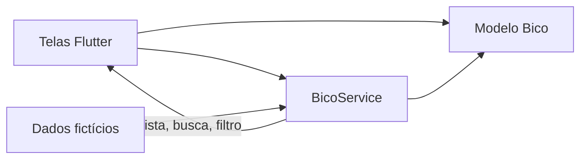
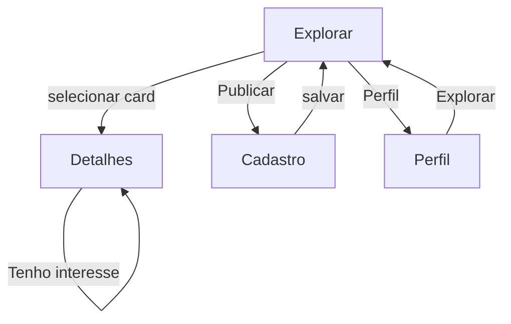

# Arquitetura da solução

## Estrutura

```text
lib/
  main.dart
  models/bico.dart
  data/bicos_data.dart
  services/bico_service.dart
  screens/ (home, detalhes, cadastro, perfil)
  widgets/bico_card.dart
```

`Bico` representa uma oportunidade e concentra invariantes de criação. `bicos_data.dart` fornece exemplos fictícios. `BicoService` mantém lista e interesses em memória, centralizando busca, filtro, cadastro e deduplicação. As telas compõem a interface e `BicoCard` reaproveita a apresentação resumida.

## Modelo de dados

| Campo | Tipo | Regra |
|---|---|---|
| id | String | identificador da sessão |
| titulo, descricao, categoria, cidade, bairro | String | conteúdo informativo |
| valor | double | maior que zero |
| data, dataCriacao | DateTime | data do serviço e criação |
| horarioInicio, horarioFim | String (`HH:mm`) | fim posterior ao início |
| quantidadeVagas | int | mínimo um |

## Organização lógica



## Navegação



## Decisões

O estado em memória atende à demonstração e evita adicionar dependências de armazenamento antes da validação do escopo. `setState`, navegação padrão do Flutter e Material 3 são suficientes para o tamanho atual. O serviço oferece um ponto único para regras que mais tarde poderão ser substituídas por persistência local sem introduzir injeção complexa. As datas e endereços iniciais são ilustrativos, não oportunidades verificadas.
